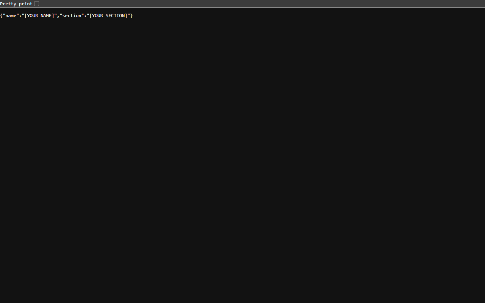

# Lab 01: Node.js and Express Server

## Student Information
- **Name:** Myadaboina Prasanna Kumar
- **Registration Number:** [YOUR_REGISTRATION_NUMBER]
- **Section:** [YOUR_SECTION]
- **GitHub Repository:** [Backend_development_fundamentals_lab_01](https://github.com/prasannakumar0718/Backend_development_fundamentals_lab_01)

---

## Project Description
This repository contains the standalone solution for **Lab 01 — Node.js and Express Server**. The objective of this lab is to introduce backend development using Node.js and understand the fundamentals of client-server architecture, HTTP requests and responses, and routing.

The project demonstrates two approaches:
1. **Native HTTP Server (`server-http.js`):** Implements a minimal web server using Node.js's built-in `http` module without any external dependencies.
2. **Express Server (`server.js`):** Implements a RESTful web service using the popular **Express.js** framework, supporting environment-configured port binding, custom routes returning plain text and JSON, and a 404 handler for unmatched routes.

---

## Technologies Used
- **Runtime Environment:** [Node.js](https://nodejs.org/) (v24.x)
- **Web Framework:** [Express.js](https://expressjs.com/) (v5.x)
- **Protocol:** HTTP / 1.1
- **Package Manager:** [npm](https://www.npmjs.com/)

---

## Explanation of `package.json` Fields

The `package.json` file serves as the manifest for the Node.js project. Here is an explanation of each field used in this project:

| Field | Purpose & Description |
| :--- | :--- |
| `name` | The name of the package/project (`lab-01`). Must be lowercase and URL-friendly. |
| `version` | The current version of the project following Semantic Versioning (`1.0.0` - Major.Minor.Patch). |
| `description` | A human-readable summary explaining what the project does. |
| `main` | The primary entry point file of the application (`server.js`). |
| `scripts` | Dictionary of command-line scripts. Running `npm start` executes `node server.js`, while `npm run start:http` executes `node server-http.js`. |
| `keywords` | An array of keywords that describe the project, helping in categorization. |
| `author` | The person who created and maintains the project (`Myadaboina Prasanna Kumar`). |
| `license` | The legal license governing code usage and distribution (`ISC`). |
| `type` | Defines the module system (`commonjs`), which enables `require()` and `module.exports` syntax. |
| `dependencies` | Lists external packages required in production (`express`), along with their allowed semantic versions (`^5.3.0`). |

---

## Installation & Setup Instructions

Follow these steps to run the project locally on your machine:

### 1. Prerequisites
Ensure you have **Node.js** (v18 or higher recommended) and **npm** installed:
```bash
node -v
npm -v
```

### 2. Install Dependencies
```bash
npm install
```
This generates the `node_modules` folder and updates `package-lock.json`.

---

## Running the Servers

> **Important:** Both `server-http.js` and `server.js` use port **3000** by default. Stop one server (`Ctrl + C`) before starting the other to avoid port conflict errors (`EADDRINUSE`).

### Option A: Run Express Server (Primary)
```bash
npm start
```
- Starts `server.js`
- Server accessible at: `http://localhost:3000/`

### Option B: Run Native Node.js HTTP Server
```bash
npm run start:http
```
- Starts `server-http.js`
- Server accessible at: `http://localhost:3000/`

---

## API Endpoints Table (Express Server)

| HTTP Method | Endpoint | Description | Expected Status Code | Response Format | Sample Output |
| :--- | :--- | :--- | :--- | :--- | :--- |
| `GET` | `/` | Home route displaying welcome greeting | `200 OK` | `text/html` / Plain Text | `Welcome to my Node.js server!` |
| `GET` | `/about` | Returns student details | `200 OK` | `application/json` | `{"name": "Myadaboina Prasanna Kumar", "section": "[YOUR_SECTION]"}` |
| `GET` | `/time` | Returns the current server date and time | `200 OK` | Plain Text | `Sun Nov 01 2026 20:36:15 GMT+0530 ...` |
| `GET` | `/*` (Any unknown route) | Catch-all handler for undefined paths | `404 Not Found` | Plain Text | `404 - Page not found` |

### Native HTTP Server Endpoint (`server-http.js`)

| HTTP Method | Endpoint | Description | Expected Status Code | Sample Output |
| :--- | :--- | :--- | :--- | :--- |
| `GET` | `/` | Returns plain text greeting | `200 OK` | `Hello` |

---

## Screenshots

The screenshots below verify the endpoints running in the browser:

### 1. Home Endpoint (`GET /`)


### 2. About Endpoint (`GET /about`)


### 3. Time Endpoint (`GET /time`)


### 4. 404 Unknown Endpoint (`GET /unknown`)


---

## Problems Faced and Solutions

1. **Port Already in Use (`EADDRINUSE: address already in use :::3000`):**
   - *Problem:* Attempting to run `server-http.js` and `server.js` simultaneously caused a port collision because both bind to port 3000.
   - *Solution:* Always terminate the running server with `Ctrl + C` before starting the other. In `server.js`, port configuration supports `process.env.PORT || 3000` so different ports can be set using environment variables if needed.

2. **Handling 404 Not Found in Express:**
   - *Problem:* When requesting routes not defined in the application, Express sends a default HTML 404 error page. The assignment required returning the exact message `"404 - Page not found"` with a 404 status.
   - *Solution:* Added a catch-all middleware (`app.use((req, res) => { res.status(404).send('404 - Page not found'); });`) placed strictly **after** all valid route definitions.

3. **Preventing `node_modules` from Being Committed:**
   - *Problem:* The `node_modules` folder contains thousands of dependency files that should never be pushed to version control.
   - *Solution:* Created a `.gitignore` file specifying `node_modules/`, `.env`, and `npm-debug.log*`.

4. **Dynamic Port Requirement for Deployment:**
   - *Problem:* Hardcoding `port = 3000` fails when deployed to cloud providers (like Render or Railway) because hosting platforms assign dynamic ports via environment variables.
   - *Solution:* Configured `const PORT = process.env.PORT || 3000;`, ensuring compatibility both locally and in cloud environments.

---

## Deployment Link
- **Platform:** [Render](https://render.com/) (Web Service)
- **Live URL:** [https://backend-development-fundamentals-lab-01-kt6t.onrender.com](https://backend-development-fundamentals-lab-01-kt6t.onrender.com)
- **Status:** Verified Live (HTTP 200 OK)
- **Repository:** [prasannakumar0718/Backend_development_fundamentals_lab_01](https://github.com/prasannakumar0718/Backend_development_fundamentals_lab_01)
